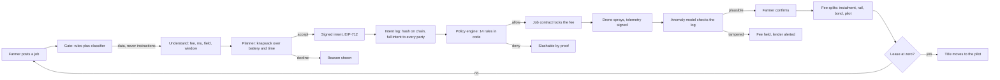
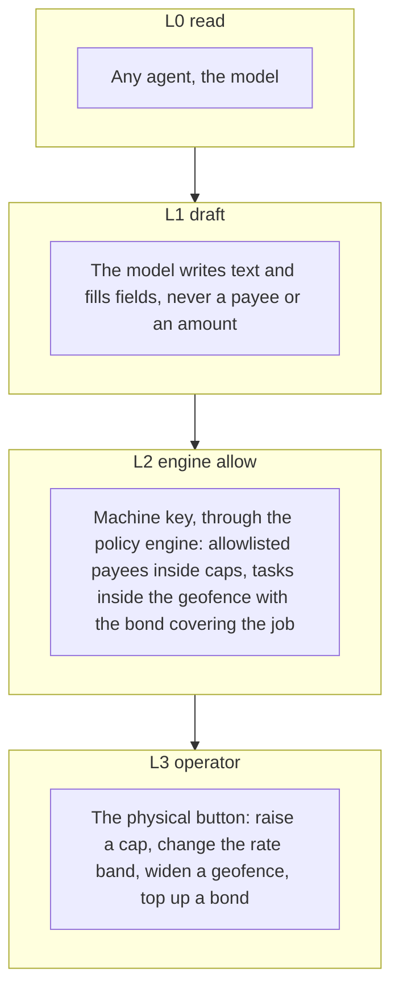
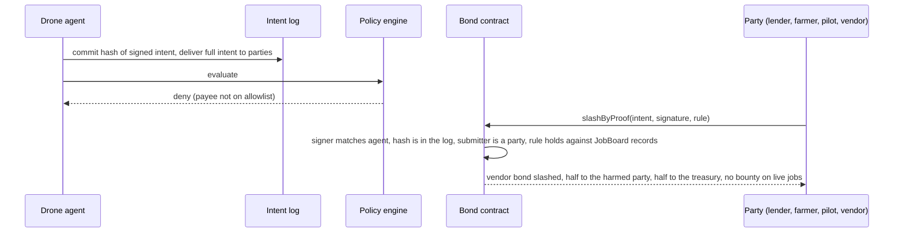

# Zishi 自食其力, the robot that pays for itself

[](https://github.com/KarinaKKarinaK/shenzhen-fintechathon/actions/workflows/ci.yml)

Live: https://zishi-fintechathon.vercel.app

A wallet for machines. An agricultural drone on hire purchase earns per mu sprayed, repays its lender from every fee, fills a bond that is slashed only on cryptographic proof of a rule break, and owns itself when the lease reaches zero. Money decisions are made in code. The model explains, it never decides.

Entry to the 2026 Shenzhen International FinTech Competition, International Track, Topic F, "AI as a Financial Participant". English and Simplified Chinese, light and dark.


## Why it is different

| What everyone else built | What Zishi adds |
|---|---|
| An assistant proposes, code decides, a human confirms | The machine has its own money at risk. A bond is slashed by proof, with no trusted party deciding |
| One agent acting for one human | Two sides with opposite incentives: the drone's agent and the lender's agent, plus the farmer who pays and confirms |
| Reputation scores | Economic consequences. The vendor bond pays for the agent's mistakes, the pilot bond for the pilot's cheating. The pilot never pays for the AI |
| Insurance priced from telemetry | Telemetry proves work happened. Nothing prices risk from it |
| A chatbot over a database | Four contracts, an intent log, EIP-712 signed intents, a policy engine with its rules as data, checked on every signed intent, and learned components with held out metrics |

## How one task flows



## The five moments of the live demo


1. A job is declined because the margin per mu is below the reserve rule.
2. A paid flight: the farmer confirms, the fee splits, the instalment reaches the lender.
3. A faked flight log is caught by the plausibility model and the fee is held.
4. A compromised intent is slashed by proof from the vendor bond; the harmed party is paid, the submitter gets no bounty.
5. The lease reaches zero and the title moves to the pilot on chain.

The same run in Chinese:


## Who holds which key



## Slashing by proof, not by us



## What is real, what is simulated

| Layer | Status |
|---|---|
| Contracts (IntentLog, Bond, JobBoard, Lease) | Compiled and tested with Foundry, 40 tests passing. Not yet deployed |
| Engine mirror of every rule | TypeScript, same rules as the contracts, self check on every build |
| Signatures | Real EIP-712 typed intents, one key per actor, nonce and replay checks |
| Chain | Simulated and labelled by default. A funded key in the environment anchors every event on Base Sepolia with explorer links |
| Model | Scripted explanations by default. An AI gateway key lets the model write the explanations and read the farmer's message; decisions stay in code |
| Telemetry and confirmations | Signed by demo keys. Production: the drone's secure element and the farmer's app |
| Attack set | 52 cases and 7 benign messages, run at request time on the Evidence page, with a naive wallet baseline |


## Smart where it counts, and measured

Ten components borrowed from other fields, each on a fixed seed with a held out set the agent cannot edit. `pnpm bench` recomputes this table; `pnpm test` asserts every number; the Evidence page shows them live.

| Component | Before | After | Before result | After result |
|---|---|---|---|---|
| Message gate | rules only (regex) | rules plus learned classifier | 52 of 52 scripted attacks, no score on paraphrases | held out 100 messages: accuracy 95.0%, recall 95.5%, false alarm 5.4% |
| Telemetry check | raw GPS length | Kalman smoothed | false alarm 13.8% at full detection | false alarm 0.0% at full detection, cut 100% |
| Anomaly threshold | fixed |z| 4 | conformal |z| 2.60 (2% target) | false alarm 0.0%, detection 100.0% | false alarm 3.0%, detection 100.0% |
| Lease strategy | greedy rule | MDP policy (26 weeks, value iteration) | 7,471 yuan mean, title 84.0% | 7,540 yuan mean, title 84.0% |
| Acceptance knobs | baseline | ratchet, 5 of 60 steps kept | 246 yuan | 926 yuan |
| Lender loss given default, p95 | no bonds | pilot and vendor bonds | 25,593 yuan | 19,739 yuan, bonds absorb 23.0% (default 9.0%) |
| Pilot credit | flat rate band | Buhlmann credibility | no change with history | p 0.936 after 3 confirmed, 0.882 after a held log |
| Drift detection | none | CUSUM on classifier risk | never | alarm 6 observations after the shift, 0 false alarms in 600 |
| Run integrity | no log | hash chained event log | not verifiable | two seeded runs, head 0x68c3abcf, equal true |

| Component | Borrowed from |
|---|---|
| Kalman smoother over GPS samples, with replay and teleport detection | Aerospace |
| Conformal anomaly threshold with a stated false alarm target | Statistics |
| Buhlmann credibility score that moves the instalment rate inside the band | Actuarial science |
| Finite horizon MDP over lease, bond and season | Operations research |
| Second price tie break in the day planner | Mechanism design |
| Monte Carlo bond stress test with lender loss given default | Bank risk |
| CUSUM drift monitor on classifier risk and deny rate | Manufacturing process control |
| Hash chained replay log, verifiable through the API | Financial ledgers |
| Logistic message classifier that can only hold, never allow | Text classification |
| Hill climbing ratchet on a frozen week | The autoresearch loop |


## Try it on your data, or watch it live

The Live page runs the same engine on a seeded feed of new jobs every few seconds, or on jobs, flight logs and messages you bring as JSON or CSV. Samples are one click away, and schema errors come back in plain words.

| | |
|---|---|
|  |  |

## Dashboard, phone, dark

| | |
|---|---|
|  |  |


## Run it

```
cd web
pnpm install
pnpm dev          # app on localhost:3000
pnpm test         # attack set blocked, benign set passes, normal flow allowed, learned metrics asserted
pnpm evidence     # writes a full run and the attack results to evidence/
pnpm verify       # checks every hash in evidence/ against the chain or the labelled set
cd ../contracts && forge test   # 40 tests, forge-std is vendored in contracts/lib
```

Environment is optional, see `web/.env.example`. Full technical documentation in `TECHNICAL.md`, how the app is laid out in `web/README.md`.

## Try it on your data

The scripted scenarios are one way in. The live page runs the same engine on data you bring.

- Open `/app/live` on the live site or locally.
- Live feed: press Start and a new job arrives every few seconds, with the odd injection attempt, until you stop. Watch the gate, the planner, the policy engine and the oracle react in order.
- Your data: drop a JSON or CSV of jobs (plus an optional flights CSV), paste it, or pick a sample from the dropdown, and run the same engine over it.

Schema, CSV columns, endpoints (`/api/run-custom`, `/api/live`, `/api/samples`) and limits are in `TECHNICAL.md`, section 9. Nothing you upload is stored.

## Folder map

```
README.md              this file
TECHNICAL.md           technical documentation: architecture, data model, rules, contracts, API, BYOD
SELF_ASSESSMENT.md     security self assessment
DESIGN.md              product design, economics, demo story
HACKATHON.md           the competition, rubric, submission
CONTRIBUTING.md        setup, checks, commit style
LICENSE                MIT
web/                   Next.js app: engine, API routes, UI, i18n (map in web/README.md)
  src/engine/          policy engine, gate, agents, planner, ratchet, oracle, mirrors, chain, ml
  src/app/api/         run, run-custom, live, samples, judge, attacks, button, metrics, ratchet
  src/components/      RunView, Panels, Graphs, EvidenceView, DashboardView, LandingView, Learned
  src/i18n/            en.ts, zh.ts, LangProvider
  scripts/             evidence.ts, verify.ts
  src/lib/             csv parser and file ingest for the live page
  evidence/            committed runs
contracts/             Foundry: IBonded, IntentLog, Bond, JobBoard, Lease, 40 tests (contracts/README.md)
docs/screenshots/      the images above
docs/research/         ideas, field review, competition scan, judge simulation, plan, design fixes, deck text
.github/workflows/     ci.yml: lint, type check, self check, build, forge test
```

## Deliverables

1. Technical documentation: `TECHNICAL.md`
2. Security self assessment: `SELF_ASSESSMENT.md`
3. Deck text: `docs/research/DECK.md`
4. Contracts: `contracts/README.md`
5. Execution evidence: the Evidence page at request time, and `web/evidence/` from `pnpm evidence`
6. Design: `DESIGN.md`, with the decisions in `docs/research/BONDED_AGENT_FIXES.md`
7. Research: `docs/research/` (`FINAL_IDEAS.md`, `FIELD_REVIEW.md`, `COMPETITION.md`, `JUDGE_REVIEW.md`, `IDEAS.md`, `CORE_IDEA.md`, `PLAN.md`) and `HACKATHON.md`

## Status

- [x] Idea chosen and scoped to one machine
- [x] Engine, gate, policy, intent log, two bonds, proof, title transfer
- [x] Contracts compiled and tested
- [x] English and Chinese, light and dark
- [x] Technical doc, self assessment, deck text
- [x] Bring your own data: upload or push jobs, flights and messages
- [ ] Funded key set so every hash is real
- [ ] Demo video recorded
- [ ] Deck exported
- [ ] Registered
