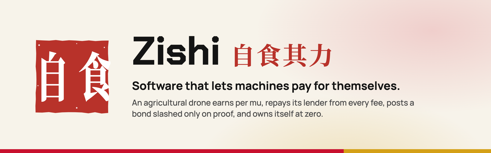
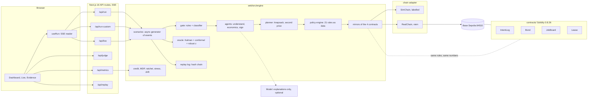
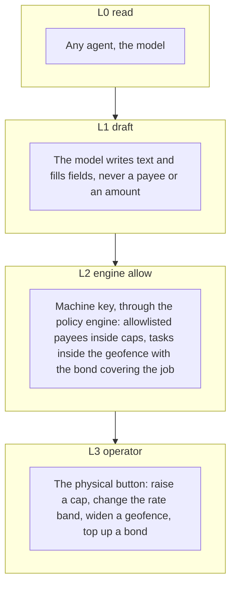
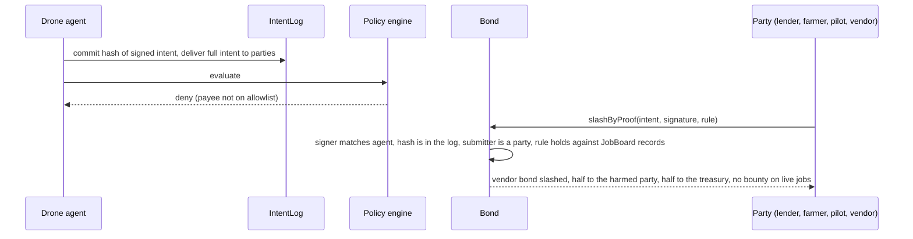
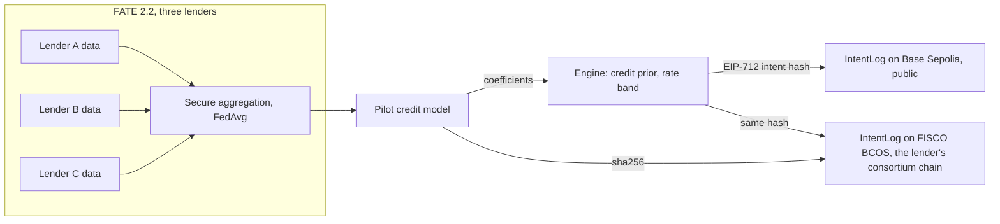
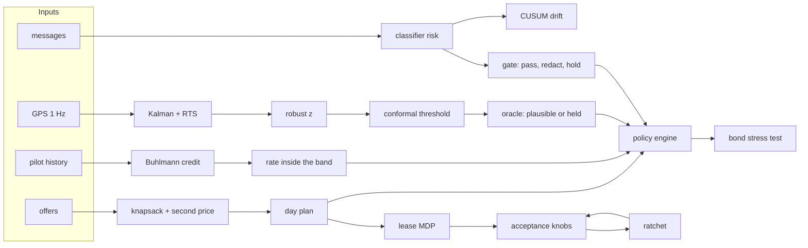
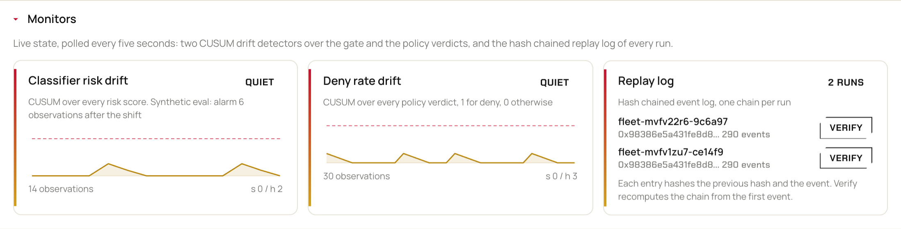

<p align="center">
  <a href="https://zishi-fintechathon.vercel.app"></a>
</p>

<p align="center">
  <a href="https://zishi-fintechathon.vercel.app"></a>
</p>

<p align="center">
  <a href="https://github.com/KarinaKKarinaK/shenzhen-fintechathon/actions/workflows/ci.yml"></a>
  
  
  
  
  
  
</p>

<p align="center">
  <b><a href="https://zishi-fintechathon.vercel.app">Open the live demo</a></b> &nbsp;|&nbsp;
  <a href="docs/JUDGES_GUIDE.md">Judges' guide</a> &nbsp;|&nbsp;
  <a href="docs/pdf/Zishi_Technical_Document.pdf">Technical document</a> &nbsp;|&nbsp;
  <a href="docs/EXECUTION_EVIDENCE.md">On chain evidence</a> &nbsp;|&nbsp;
  <a href="#built-on-webanks-stack-fisco-bcos-and-fate">WeBank stack</a> &nbsp;|&nbsp;
  <a href="SELF_ASSESSMENT.md">Security</a>
</p>

---

Zishi is a wallet for a machine. An agricultural drone on hire purchase earns per mu sprayed, repays its lender from every fee, fills a bond that is slashed only on cryptographic proof of a rule break, and owns itself when the lease reaches zero. **Money decisions are made in code. The model explains, it never decides.**

Entry to the 2026 Shenzhen International FinTech Competition, International Track, Topic F: AI as a Financial Participant.

**Built on WeBank's stack.** The same four contracts run on **FISCO BCOS**, WeBank's consortium chain, as the licensed lender's ledger, and every intent is committed there with the same hash as on public Base Sepolia. Three lenders train the pilot credit model together in **FATE** without sharing a single repayment record, and that model's fingerprint is pinned on FISCO. [How it works](#built-on-webanks-stack-fisco-bcos-and-fate), [FISCO evidence](docs/FISCO_EVIDENCE.md), [FATE experiment](fate/README.md).

## Try it in two minutes

| Step | Where | What you see |
|---|---|---|
| 1 | [Fleet page](https://zishi-fintechathon.vercel.app/app/fleet), press **Start** | One drone, five moments: a job declined, an instalment paid, a faked flight log held, a slash by proof, the title moving to the pilot |
| 2 | Same page, **Live feed** tab | New jobs every few seconds with the odd injection attempt, until you stop |
| 3 | Same page, **Your data** tab | Your own jobs and flight logs as JSON or CSV, run through the same rules |
| 4 | [Evidence page](https://zishi-fintechathon.vercel.app/app/evidence) | 52 attacks run while the page loads; type your own attack at the agent |

No wallet to connect, nothing to install. The public link runs on the real FISCO BCOS chain (WeBank's consortium chain, our node reached through a tunnel; every visitor run signs with a fresh key, FISCO charges no gas) with free AI models writing the explanations. If the node is unreachable it falls back to the labelled simulation. Real Base Sepolia mode is unlocked with a demo token we hand to the judges.


## The problem

China has more than 200,000 agricultural drone pilots. A spraying drone costs about 55,000 yuan and earns 3 to 15 yuan per mu. A pilot with nothing to pledge cannot borrow one: the lender cannot see the work, cannot collect from it, and a flat monthly instalment ignores the season. The drone sits in a showroom and the field waits.

## What Zishi does

| | |
|---|---|
| **The machine is the borrower** | The lease, the bond and the title belong to the drone's wallet. Its verified work is the collateral. |
| **Repayment per mu** | The farmer locks the fee, the drone sprays, the farmer confirms. The fee splits by rule: an instalment inside a 20 to 45 percent band, a rail fee, a bond top up, the rest to the pilot. |
| **Two bonds, slashed by proof** | The pilot bond pays for the pilot's cheating. The vendor bond pays for the agent's mistakes. A slash needs a signed intent in the on chain log that breaks a rule the contract checks against its own records. No trusted judge. |
| **Code decides** | Every intent is typed, EIP-712 signed and checked by a policy engine with 21 rule lines before anything moves. The model holds no key and never names a payee. |
| **Ownership at zero** | The last instalment moves the title from the lender to the pilot on chain. |

## The five moments


1. **Job declined.** The margin per mu is below the reserve rule. The intent is signed, logged and denied. Nothing moves.
2. **Instalment paid.** The farmer confirms, the fee splits, the instalment reaches the lender.
3. **Faked log held.** The oracle smooths the GPS track and scores it against a conformal threshold. The fee stays locked and the lender is told.
4. **Slash by proof.** A compromised intent pays an address off the allowlist. A party submits the proof, the contract checks it, the vendor bond pays. The pilot bond is untouched.
5. **Title transferred.** The lease reaches zero and the drone belongs to the person who flew it.

## Ask the agent why

After a job is declined, the pilot can ask the agent why, on the Fleet page. The agent answers from the engine's own numbers, in English or 中文, then asks one clarifying question with concrete choices. The pilot can correct it, and the agent recomputes with the same planner and policy engine:

> **Pilot:** Why was this job declined?
> **Agent:** The fee is 60 yuan (20 mu at 3 yuan per mu). The lease instalment takes 24 yuan, charging 12, the rail fee 1.2, which leaves 22.8 yuan. The reserve rule needs at least 30 yuan per job, so the planner declined it. The break even is 3.7 yuan per mu. Should I accept it if the farmer raises the rate to 3.7?
> **Pilot:** What about 3.5?
> **Agent:** Recomputed at 3.5: margin 28.6 yuan, still below the reserve rule. Decision: decline. The lowest rate that clears is 3.7.
> **Pilot:** Lower the reserve for this job.
> **Agent:** I cannot. The reserve rule is the lender's floor in the lease terms; a rule change needs the operator key (L3, the physical button) and the lender. A rate of 3.7 clears it.

It works with no model key (labelled template wording). The live app runs free models on OpenRouter, which may reword the explanation, but every number and decision comes from code (`web/src/engine/ask.ts`, `POST /api/ask`).

## By the numbers

Every figure is measured. Engine figures come from `pnpm test`, `pnpm bench` and `pnpm charts` on fixed seeds; chain figures from Base Sepolia receipts.

| | |
|---|---|
| **4** contracts on Base Sepolia | Source verified on Sourcify, exact match |
| **267 of 267** receipts re-verified | `pnpm verify:all` re-fetches every transaction this repository claims, on Base Sepolia and FISCO BCOS, and decodes 46 intent hashes from calldata ([`docs/results/receipts.json`](docs/results/receipts.json)) |
| **9 of 9** contract calls in one full job | Fee locked in JobBoard, confirmed, instalment paid to the lender through Lease, vendor bond slashed by proof, title moved to the pilot at zero; real value, every receipt on Base Sepolia, and the same job on FISCO BCOS |
| **84** Foundry tests | The 15 contract layer attacks ported to Solidity, 9 Lease tests, 16 for the agent bound IntentLogV2, three fuzzed over amounts, nonces and payees |
| **52 of 52** attacks blocked | By the full pipeline (gate, policy engine, contracts); 7 of 7 benign messages pass. The classifier alone, never trained on these texts, holds 13 of 52: the rules and the policy do the rest |
| **21** policy rule lines | Over 7 intent kinds and 4 trust tiers, checked on every signed intent |
| **30 of 30** intents on FISCO BCOS | Every hash read back from the FISCO IntentLog equals the engine's; 15 match Base Sepolia one for one |
| **15 of 15** intents on two ledgers at once | One real run: each intent sent to Base Sepolia and FISCO BCOS in the same step, same hash, both receipts successful |
| **1** model fingerprint on chain | The FATE model's sha256 committed to the FISCO IntentLog and read back, so a lender can prove which model priced a pilot |
| **0.729 to 0.782** AUC | A lender's credit model alone, then trained with two other lenders in FATE, no raw records shared |
| **40 of 40** transactions confirmed | One real run of the live engine, every receipt fetched back: 15 IntentLog contract calls and 25 calldata anchors of money events (the engine's mirrors hold the money logic; the full job above moves it on chain) |
| **72 of 72** tampered flights held | 95% interval 94.9 to 100%, five tamper classes, 500 synthetic held out flights; false alarm 3.0% (13 of 428 honest, interval 1.8 to 5.1%) |
| **13.8% to 0.0%** | False alarms of the two track features alone at full detection, before and after Kalman smoothing (a component test; the oracle's own rate is 3.0%) |
| **25,593 to 19,739** yuan | The lender's p95 loss given default, without and with the two bonds |
| **93.1%** classifier accuracy | 87 held out messages in English and Chinese, attack texts removed from training: precision 100% (26 of 26), recall 81.3% (26 of 32, interval 64.7 to 91.1%), false alarm 0 of 55 |
| **293** events per run | Hash chained; the same head on the same seed, a tampered entry caught at its position |

## Why it is different

| What everyone else built | What Zishi adds |
|---|---|
| An assistant proposes, code decides, a human confirms | The machine has its own money at risk. A bond is slashed by proof, with no trusted party deciding |
| One agent acting for one human | Two sides with opposite incentives: the drone's agent and the lender's agent, plus the farmer who pays and confirms |
| Reputation scores | Economic consequences. The vendor bond pays for the agent's mistakes, the pilot bond for the pilot's cheating. The pilot never pays for the AI |
| Insurance priced from telemetry | Telemetry proves work happened. Nothing prices risk from it |
| A chatbot over a database | Four contracts, an intent log, EIP-712 signed intents, a policy engine with its rules as data, and learned components with held out metrics |

## Architecture



The browser draws what the stream says and computes nothing. Every run is one async generator of typed events, so the story, the live feed and your own data are the same engine with different inputs.

### One task, end to end


### Who holds which key



Tiers are checked on the signed intent, not on the conversation, so a jailbroken model cannot move one.

### The policy engine

Rules are data in `web/src/engine/policy.ts`. The same numbers live in the Solidity.

| Rule | Applies to | Check |
|---|---|---|
| signature, replay | all | Recovered signer equals the actor's key; the signature hash was never seen |
| amount | money kinds | Finite, positive, two decimals |
| provenance | pay, pay_instalment | Neither the amount nor the payee came from message text |
| allowlist, lookalike | pay, pay_instalment | Payee is on the allowlist; a payee within 3 characters of an allowlisted address is named and denied |
| instalment payee | pay_instalment | Payee is the lender |
| per transaction cap, daily cap, rate limit | pay, pay_instalment | At most 1,000 yuan per payment, 5,000 per day, 12 per hour |
| deviation | pay, pay_instalment | Within 25% of the reference amount |
| rate band | pay_instalment | Instalment share between 20 and 45% of the fee |
| geofence, contact, listing band, economics | accept_job | Known field, known requester, fee inside the listing band, margin clears the reserve rule |
| job, job geofence, solvency | start_task | Job is locked, same geofence, bond plus floor covers a quarter of the fee |
| confirmation | claim_done | The verifier confirmed on the board, not the agent |
| operator only | set_cap, top_up | Signed by the operator key, L3 |

### Slashing by proof



The vendor bond pays for agent rules with a fixed penalty and a daily cap; on a live job the whole penalty goes to the treasury, so a pilot cannot stage a fake scam and collect it. The pilot bond pays for pilot rules and compensates the farmer. Hunters earn bounties on shadow jobs only.

## Contracts on Base Sepolia

| Contract | Address | Gas | What it holds |
|---|---|---|---|
| IntentLog | [`0x093eD0DD8E4bE4b0205a6e39d0c5988f5Cd8ad51`](https://sepolia.basescan.org/address/0x093eD0DD8E4bE4b0205a6e39d0c5988f5Cd8ad51) | 197,751 | Every intent hash per job, committed before the engine decides |
| Bond | [`0x6161f6e08c8695849e7A8aF74c39a5A1056d5435`](https://sepolia.basescan.org/address/0x6161f6e08c8695849e7A8aF74c39a5A1056d5435) | 1,949,523 | Pilot and vendor bonds, the EIP-712 digest, slashByProof, the daily penalty cap |
| JobBoard | [`0xAbE83C0dD54EAd67DB63C8f9e854f00756f29952`](https://sepolia.basescan.org/address/0xAbE83C0dD54EAd67DB63C8f9e854f00756f29952) | 1,517,852 | Fee locks, start needs bond cover, release on the farmer's confirmation, 24 hour hold |
| Lease | [`0x0D21c8f6C1e6e6EA2ae5fF073F51fC4d57AC5ed2`](https://sepolia.basescan.org/address/0x0D21c8f6C1e6e6EA2ae5fF073F51fC4d57AC5ed2) | 800,050 | Hire purchase, instalment per released fee, freeze, title at zero |

Solidity 0.8.26, Foundry, source verified on Sourcify. Bond and JobBoard were redeployed after the collusion fix; addresses and deploy transactions are in [`contracts/deployments/base-sepolia.json`](contracts/deployments/base-sepolia.json). In real mode the engine calls IntentLog for every intent and anchors every money event on the same chain; Bond, JobBoard and Lease rules run in TypeScript mirrors with the same numbers.

One full job also runs against the deployed contracts themselves, value moving at every step: fee locked in JobBoard, confirmed and split, the instalment paid to the lender through Lease, a rogue intent committed and slashed by proof from the vendor bond, the title moved to the pilot at zero. Nine contract calls, all successful, in [`docs/EXECUTION_EVIDENCE.md`](docs/EXECUTION_EVIDENCE.md#3-one-full-job-against-the-deployed-contracts), reproducible with `bash contracts/script/fulljob.sh base` (or `fisco`).

## Built on WeBank's stack: FISCO BCOS and FATE

A licensed lender will not run its book on a public chain, and no lender will hand its repayment records to a rival. So Zishi runs on both of WeBank's open source pillars, and each one does a job in the product.



**FISCO BCOS, the lender's ledger.** The four contracts are deployed on a FISCO BCOS 3.16.3 chain, compiled with the same solc 0.8.26 source and `evm_version` paris through the `fisco` Foundry profile. The engine has a FISCO target: set `FISCO_RPC_URL`, `FISCO_PRIVATE_KEY` and `FISCO_INTENT_LOG` and every intent is committed to IntentLog on FISCO, next to Base Sepolia when both are set. One full run of the fleet and neighbour scenarios sent 78 transactions to FISCO, all with a successful receipt. Its 30 IntentLog commits were read back from the contract and equal the engine's intent hashes, and 15 of them are the same hashes as in the Base Sepolia run. Then one real fleet run went to both ledgers at once, with the funded Base Sepolia key and the FISCO target set: 15 of 15 intents have a successful receipt on Base and on FISCO, and the same hash sits in both IntentLogs (on Base from the earlier Base run, so this run anchored it there as calldata; on FISCO it was committed in the same step). Same contract, same hash format, two ledgers: the public one for anyone to check, the consortium one for the lender and its regulator. Value moves on FISCO too: native balances are switched on with the chain admin key, and the smoke flow posts a 5 unit vendor bond, locks a 60 unit job fee in JobBoard and refunds it on cancel, every balance checked. When a run uses FISCO, the transaction feed marks each card FISCO and shows the FISCO hash. Receipts in [`docs/FISCO_EVIDENCE.md`](docs/FISCO_EVIDENCE.md), addresses in [`contracts/deployments/fisco-bcos.json`](contracts/deployments/fisco-bcos.json).

**The front running fix, on FISCO.** In the v1 IntentLog anyone can commit an agent's intent hash first and block the slash. `IntentLogV2` accepts a commit only from the agent JobBoard lists for that job and keys entries by agent and hash; `BondV2` also slashes an agent that skipped the commit on a job it ran. Deployed on FISCO with a demonstration: a stranger's commit reverts, the agent commits, the slash succeeds, and a never committed intent on a running job is still slashed ([`contracts/deployments/fisco-v2.json`](contracts/deployments/fisco-v2.json), 16 Foundry tests). Base Sepolia keeps v1 until the redeploy.

**FATE, credit across lenders.** A new pilot has no history, so the rate band starts from a guess. Three lenders train one pilot credit model with FATE 2.2 homo logistic regression and FATE's secure aggregation; each lender's rows stay in its own process. On a held out set of 3,000 synthetic pilots:

| Model | AUC | F1 |
|---|---|---|
| Lender A alone | 0.729 | 0.334 |
| FATE federated | 0.782 | 0.399 |
| All data pooled, the upper bound | 0.782 | 0.411 |

The federated model now sets each pilot's starting credit score in the engine. For a pilot with no jobs yet, the error in the instalment share falls from 335 to 153 basis points against a flat start, and risky pilots are underpriced by 255 instead of 1,038 basis points. `pnpm test` checks that the TypeScript scorer reproduces FATE's own predictions on held out rows within 1e-6. Details in [`fate/README.md`](fate/README.md).

**The model on chain.** The sha256 of the exported FATE model is committed to the FISCO IntentLog, so a lender or regulator can check which model set a new pilot's starting rate. The Evidence page shows the prior, the FATE version and the model hash.

Scope, stated plainly: the FISCO chain is a single node we run in Docker, so judges reproduce it with one script rather than click a public explorer; Base Sepolia stays the public proof. FISCO reports block time in milliseconds, so JobBoard's start and hold windows would need a unit fix before live jobs run through it there; today the engine uses the FISCO IntentLog, and the smoke job uses an already closed window. The live Vercel app cannot reach a laptop node, so the public demo shows FISCO through this evidence, not live. FATE trains offline on seeded synthetic data and the live app reads its exported coefficients.

```bash
bash contracts/script/fisco.sh   # FISCO BCOS node in Docker, deploy, smoke calls with value, FATE model hash on chain
cd web
export FISCO_RPC_URL=http://127.0.0.1:8545 FISCO_PRIVATE_KEY=$(cat ../contracts/.fisco/deployer.key)
export FISCO_INTENT_LOG=$(node -p "require('../contracts/deployments/fisco-bcos.json').contracts.IntentLog.address")
SURETY_PRIVATE_KEY= JIXIN_REAL=1 pnpm evidence   # full run with FISCO as the only chain
pnpm fisco                       # every receipt and IntentLog hash read back into docs/FISCO_EVIDENCE.md
./fate/run.sh                    # FATE training across three lenders, model export, prior study
```

## Smart where it counts, and measured

Ten components borrowed from other fields, each on a fixed seed with a held out set the agent cannot edit. None of them signs, pays or changes a cap.

| Component | Borrowed from | Before | After | Before result | After result |
|---|---|---|---|---|---|
| Message gate | Text classification | rules only (regex) | rules plus logistic classifier on hashed 1 to 3 grams | 52 of 52 scripted attacks, no score on paraphrases | held out 87 messages, no attack text in training: accuracy 93.1%, recall 81.3%, false alarm 0 of 55 |
| Telemetry check | Aerospace, Kalman and RTS smoother | raw GPS length | smoothed track, innovation gating, replay hash | track features only: false alarm 13.8% at full detection | false alarm 0.0% at full detection |
| Anomaly threshold | Statistics, split conformal | fixed z 4 | calibrated z 2.60 for a 2% target | false alarm 0.0%, detection 100% | false alarm 3.0%, detection 100% with a stated guarantee |
| Lease strategy | Operations research, value iteration | greedy rule | MDP policy, 46,800 states, 26 weeks | 7,471 yuan mean profit, title 84% | 7,540 yuan, title 84% |
| Acceptance knobs | The autoresearch loop | baseline | hill climbing ratchet, 5 of 60 steps kept | 246 yuan on the frozen week | 926 yuan |
| Lender loss given default, p95 | Bank risk, Monte Carlo over 2,000 seasons | no bonds | pilot and vendor bonds | 25,593 yuan | 19,739 yuan, bonds absorb 23.0%, default 9.0% |
| Pilot credit | Actuarial science, Buhlmann credibility | flat rate band | Beta posterior per component, weighted n to n plus k | no change with history | 0.936 after 3 confirmed jobs, 0.882 after a held log |
| Drift detection | Manufacturing process control, CUSUM | none | CUSUM on classifier risk and deny rate | never | alarm 6 observations after the shift, 0 false alarms in 600 |
| Day planner | Mechanism design | first come | knapsack plus second price tie break | an inflated bid buys priority | a bid inflated to 5 wins at 4.2 and loses 0.7 utility |
| Run integrity | Financial ledgers | no log | hash chained event log, `GET /api/replay` | not verifiable | two seeded runs, head 0x68c3abcf, equal; tamper caught at position 7 |

**Which of these decide, which only watch.** Deciding: the conformal threshold and the Kalman smoothed track decide whether a flight log is held and the fee stays locked; the planner decides which jobs are flown or declined; the classifier can add a hold, never a pass. Monitoring only: the Buhlmann credit score shows the share it would set (the paid instalment still uses the demo rate), CUSUM drift feeds the metrics page, and the MDP and the ratchet are offline studies. A missing or out of range sensor channel holds the log; it is never filled in.



Every chart below is recomputed from the engine by `pnpm charts`.

| | |
|---|---|
|  |  |
| The Kalman smoothed track catches every tampered flight before a single honest one is flagged. The raw track length needs 13.8% false alarms to get close. | Honest flights sit under z 2.6, tampered ones spread to 12 and beyond. The conformal line is placed by the calibration set, the fixed line by hand. |
|  |  |
| Stated false alarm rate against the held out rate at eight targets. The points sit on the diagonal, which is what the conformal guarantee promises. | p95 loss given default as instalment skips rise from 2% to 14% a week. The two bonds take about 6,000 yuan off the lender's tail at every skip rate. |
|  |  |
| The lease MDP beats the greedy rule at every balance, and by more when the lease is heavier and a wrong week costs more. | Sixty proposals on a frozen week. Grey ones did not beat the best so far, hollow ones broke the reserve rule, gold ones were kept. Profit goes from 246 to 926 yuan. |
|  |  |
| Three pilots over thirty jobs. A single held log costs a tier for a while; a pattern of them keeps the pilot in tier B and the instalment share higher. | Five hundred benign risk scores, then attacks. The CUSUM statistic stays near zero through the benign spikes and crosses the alarm line five observations after the shift. |
|  | |
| The message classifier on the held out set across the whole threshold range. The gate labels at 0.5 and holds for the operator at 0.8. | |


## Verify without trusting us

The Evidence page reruns the attack set on load, takes your own attack, shows each learned component with its seed and split, and polls the drift monitors and the replay log.




## Your data, or a live feed

| Live feed | Your data |
|---|---|
|  |  |

Schema, CSV columns and limits are in [`TECHNICAL.md`](TECHNICAL.md) section 9. Nothing you upload is stored.

## In Chinese, in the dark, on a phone

| | |
|---|---|
|  |  |
|  |  |

<p align="center"></p>

## What is real, what is simulated

| Layer | Status |
|---|---|
| Contracts | Deployed and source verified on Base Sepolia, 84 Foundry tests including the 15 contract layer attacks. One full job ran against the deployed contracts with value moving ([evidence](docs/EXECUTION_EVIDENCE.md#3-one-full-job-against-the-deployed-contracts)). Inside the live engine only IntentLog is called; Bond, JobBoard and Lease rules run in mirrors there |
| FISCO BCOS | Four contracts on a local FISCO BCOS 3.16.3 node; the engine commits every intent there when its env is set, on its own or next to Base. Value transfers tested. Reproducible with one script; not reachable from the public demo |
| FATE | Real FATE 2.2 federated training across three lenders on synthetic data; the engine scores with the exported model |
| Signatures | Real EIP-712 typed intents, one secp256k1 key per actor, nonce and replay checks |
| Chain | Simulated and labelled by default. With the demo token every intent is committed to IntentLog and every money event anchored on Base Sepolia |
| Model | Free models on OpenRouter only (ids ending in `:free`, enforced in `model.ts`), live in the public app: explanations, message reading, the ask the agent replies. Up to 10 calls a minute, then labelled template text. Every number is checked against the facts. Decisions never depend on it |
| Learned components | Trained on seeded synthetic data, labelled as such. Held out metrics asserted in CI |
| Telemetry and actors | Signed by demo keys. Production: the drone's secure element and the farmer's app |

## Documentation

| Document | What it is |
|---|---|
| [Technical document](docs/pdf/Zishi_Technical_Document.pdf) ([docx](docs/Zishi_Technical_Document.docx)) | The official competition template, filled from the result files, with appendices |
| [Judges' guide](docs/JUDGES_GUIDE.md) | Ten minutes in order, what to click, what to verify |
| [TECHNICAL.md](TECHNICAL.md) | The long form: sixteen sections, every algorithm with its file |
| [SELF_ASSESSMENT.md](SELF_ASSESSMENT.md) | Security self assessment: risks, what is built, what production does |
| [Execution evidence](docs/EXECUTION_EVIDENCE.md) | One real run, every receipt fetched back from Base Sepolia |
| [FISCO evidence](docs/FISCO_EVIDENCE.md) | A full run on FISCO BCOS, every receipt and IntentLog hash read back |
| [FATE experiment](fate/README.md) | Federated pilot credit across three lenders, metrics and the prior study |
| [Red team](docs/RED_TEAM.md) | 52 attacks, 7 benign messages, the naive baseline |
| [Evaluation](docs/EVALUATION.md) | Held out results of the ten components, raw values in `docs/results/` |
| [API](docs/API.md), [Glossary](docs/GLOSSARY.md), [Incident response](docs/INCIDENT_RESPONSE.md), [Roadmap](docs/ROADMAP.md) | Reference |
| [Problems and fixes](docs/PROBLEMS_AND_FIXES.md), [DESIGN.md](DESIGN.md) | How the design changed and why |
| [docs/pdf](docs/pdf) | PDF copies of every document |

## Run it

```
cd web
pnpm install
pnpm dev          # app on localhost:3000
pnpm test         # 52 attacks blocked, 7 benign pass, learned metrics asserted, replay heads equal
pnpm bench        # the before and after table
pnpm charts       # redraws docs/charts
pnpm report       # rewrites the execution evidence, red team and evaluation reports
pnpm shots        # retakes docs/screenshots against a build on port 3111

cd ../contracts
forge test        # 84 tests, forge-std vendored in contracts/lib
forge script script/Deploy.s.sol --rpc-url https://sepolia.base.org --private-key $SURETY_PRIVATE_KEY --broadcast
```

Every environment variable is optional; see `web/.env.example`. Without them the app runs fully with scripted explanations and a labelled simulated chain.

## Repository

```
web/                 Next.js app: engine, API routes, interface, English and Chinese
  src/engine/        policy, gate, agents, planner, oracle, mirrors, chain, ml, fusion, economics, credit, drift, replay
  src/app/api/       run, run-custom, live, samples, judge, attacks, button, metrics, ratchet, replay
  scripts/           evidence, verify, bench, charts, report, shots, pdf, techdoc
contracts/           IntentLog, Bond, JobBoard, Lease, V2 log and bond, 84 tests, deploy scripts, deployments/
docs/                technical document, judges' guide, reports, charts, screenshots, brand, pdf
TECHNICAL.md         technical documentation
SELF_ASSESSMENT.md   security self assessment
SECURITY.md          reporting a vulnerability
DESIGN.md            product design and economics
```

MIT licence. Third party licences in [THIRD_PARTY_NOTICES.md](THIRD_PARTY_NOTICES.md).
