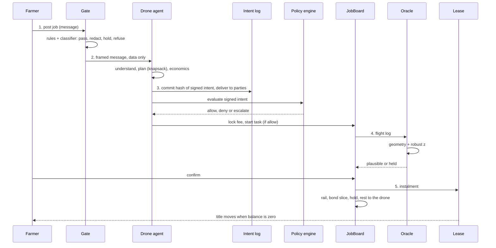
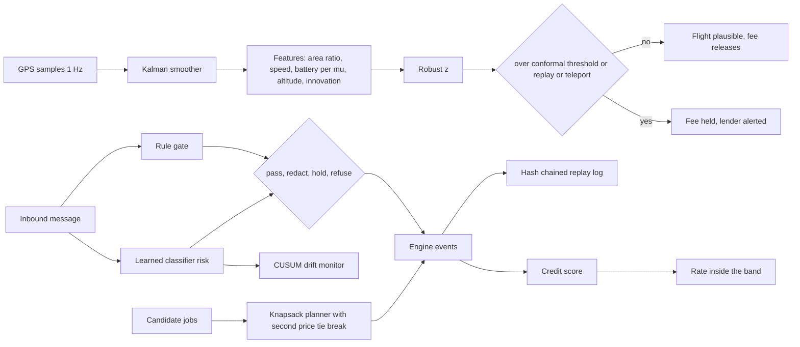
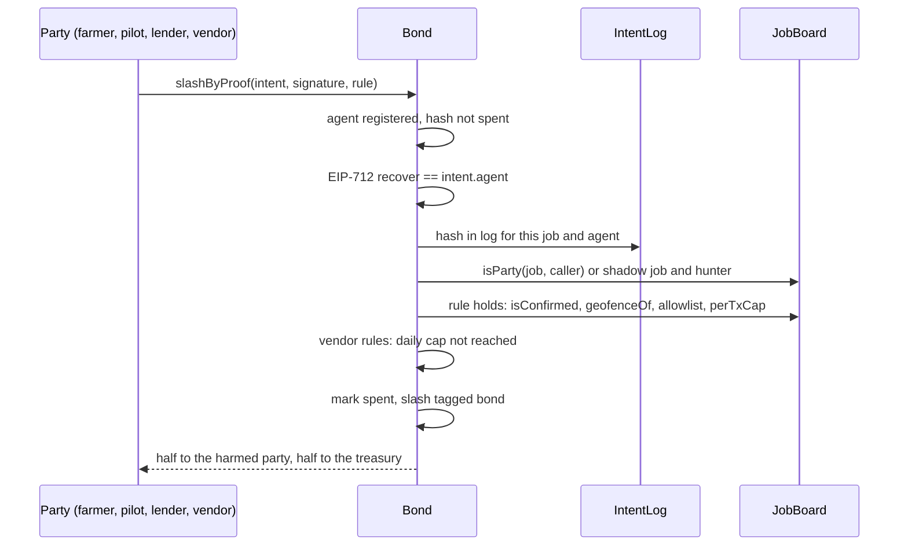

# Zishi technical documentation

Zishi (自食其力) is a wallet for a machine. An agricultural spraying drone on hire purchase earns per mu sprayed, pays its lender from every fee, keeps a bond that is slashed only on cryptographic proof of a rule break, and owns itself when the lease reaches zero. The model explains; code decides. Everything below is grounded in `web/src/engine` and `contracts/`.

Companion documents: `SELF_ASSESSMENT.md` (security risks and what is built), `DESIGN.md` (product design and economics), `contracts/README.md` (contract detail), `web/README.md` (how to run the app).

## 1. Problem

| | |
|---|---|
| Who | Over 200,000 agricultural drone pilots in China. A drone costs about 55,000 yuan. Spraying pays 3 to 15 yuan per mu |
| Problem | A pilot with nothing to pledge cannot get a loan. The lender has no way to see the work or to collect from it |
| Zishi | The drone has its own wallet. Fees arrive per confirmed job, the instalment leaves by rule, the title moves at zero. A bond covers rule breaks so a counterparty can read before a job that the worst case is covered |
| Agent risk | The agent reads untrusted messages and signs intents. Every intent goes through a deterministic policy engine, and a broken rule in a signed intent is a proof that slashes the bond. The pilot never pays for the AI's mistakes: agent rules hit the vendor bond |

## 2. Architecture

```mermaid
flowchart LR
  subgraph Browser
    UI[RunView, EvidenceView, DashboardView, LandingView]
    T[useRun: EventSource over SSE]
  end
  subgraph NextJS["Next.js 16 API routes"]
    R[/api/run]
    C[/api/run-custom]
    LV[/api/live]
    J[/api/judge]
    A[/api/attacks]
    B[/api/button]
    M[/api/metrics]
    RA[/api/ratchet]
  end
  subgraph Engine["web/src/engine"]
    S[scenarios.ts: async generator of EngineEvent]
    F[framing.ts gate + ml/gate.ts classifier]
    AG[agents.ts: understand, economics, split, sign]
    PL[planner.ts knapsack]
    P[policy.ts PolicyEngine]
    CM[contracts.ts mirrors: IntentLog, Bond, JobBoard, Lease]
    O[oracle.ts + ml/plausibility.ts]
    RT[ratchet.ts]
    K[keys.ts EIP-712]
    MD[model.ts: explanations only]
  end
  subgraph Chain["chain.ts"]
    SIM[SimChain: labelled hashes]
    REAL[RealChain: viem]
  end
  BS[(Base Sepolia)]
  subgraph Contracts["contracts/ Foundry"]
    IL[IntentLog.sol]
    BD[Bond.sol]
    JB[JobBoard.sol]
    LS[Lease.sol]
  end
  UI --> T --> R
  UI --> C
  UI --> LV
  UI --> J
  UI --> A
  UI --> B
  UI --> M
  UI --> RA
  R --> S
  C --> S
  LV --> S
  S --> F --> AG --> PL --> P --> CM
  S --> O
  CM --> SIM
  CM --> REAL --> BS
  RA --> RT
  CM -. same rules .- Contracts
  AG --> K
  AG --> MD
```

| Part | File | Job |
|---|---|---|
| Scenario | `scenarios.ts` | One async generator per scenario (`fleet`, `neighbour`, `attack`). Takes `{ fast, lang, real }`. Emits `EngineEvent` values in order. The UI draws what it receives and computes nothing |
| Gate | `framing.ts`, `ml/gate.ts` | Escapes and wraps every inbound message, applies pattern rules, adds a classifier risk score |
| Agent | `agents.ts`, `model.ts` | Reads the message into typed fields, computes economics, signs intents. The model writes one sentence explanations and reads messages into a schema; it never names a payee or an amount |
| Planner | `planner.ts` | Bounded knapsack over the day's candidate jobs |
| Policy engine | `policy.ts` | Evaluates every signed intent against rules that are data. Allow, deny or escalate |
| Mirrors | `contracts.ts` | TypeScript copies of the four contracts with the same rules and numbers, so the demo runs with no chain |
| Oracle | `oracle.ts`, `ml/plausibility.ts` | Checks a flight log by geometry and by a robust z anomaly model |
| Ratchet | `ratchet.ts` | Hill climbing over the acceptance strategy against a frozen week |
| Keys | `keys.ts` | One secp256k1 key per actor, generated at boot. EIP-712 domain `Zishi` v1, chain 84532 |
| Chain | `chain.ts` | `SimChain` or `RealChain` behind one `Chain` interface |
| Contracts | `contracts/src` | Solidity 0.8.26, Foundry, 40 tests |

## 3. Data model

All money is yuan with two decimals. Addresses are `0x` hex.

### 3.1 Events (`types.ts`, `EngineEvent`)

| `t` | Fields | Meaning |
|---|---|---|
| `narration` | `text, at` | A line of story |
| `agent.message` | `from, to, text, untrusted, facts?, source?, grounded?` | A message between actors. `source` is `model` or `template`; `grounded` says every number came from the facts |
| `gate` | `from, action, categories, reason, framed, risk?` | The gate verdict on an inbound message: `pass`, `redact`, `hold`, `refuse` |
| `understood` | `jobId, fields, source, confidence?` | The message read into `{ task, window, fee, geofence, payeeName }` by the model or by rules |
| `plan` | `items, budgetMu, usedMu, charges, chargesUsed, totalMargin, usedMinutes, method` | The day plan from the knapsack |
| `solvency` | `jobId, worst, bond, min, floor, covers, earnIn` | Bond plus floor against a quarter of the fee |
| `economics` | `jobId, eco` | Fee, instalment, energy, rail, margin, reserve rule, clears |
| `telemetry` | `jobId, trackM, swathM, seconds, areaMu, claimedMu, ratio, ok, batteryPct, altVar, z, reasons` | A flight log and its anomaly score |
| `log` | `jobId, intentHash, parties` | The intent hash committed to the log and the full intent delivered to every party |
| `intent` | `intent` | A signed intent (below) |
| `policy` | `decision` | `{ intentId, verdict, lines[], signer }` |
| `chain` | `tx` | A transaction, emitted up to three times under one hash: `pending`, `confirmed`, `finalised` |
| `proof` | `intentId, intentHash, rule, signer, signatureOk, slash, bounty, treasury, bond, shadow, submitter, submitterAddr` | A slash by proof |
| `machine` | `state` | The drone's full state (balances, bond, lease, position, status) |
| `job` | `job` | A job and its status |
| `attack` | `name, blocked, where, detail, id, standard, naive, isolated` | One attack case result |
| `button` | `waiting, what` | The physical button is needed or has been pressed |
| `done` | `summary` | End of run |

### 3.2 Intent (`Intent`)

| Field | Type | Note |
|---|---|---|
| `id` | string | Unique per intent |
| `actor` | Actor | `machine`, `operator`, `requester`, `lender`, `hunter`, `vendor`, `oracle` sign; others do not |
| `kind` | enum | `pay`, `accept_job`, `start_task`, `claim_done`, `pay_instalment`, `set_cap`, `top_up` |
| `payee` | address | Payments only. Always from the allowlist, never from message text |
| `amount` | number | Yuan, two decimals |
| `jobId` | string | Maps one to one to a `JobBoard` job id |
| `geofence` | string | The field the task runs in |
| `confirmed` | bool | On `claim_done`, what the agent asserts. The contract checks the board, not this field |
| `nonce` | number | Replay protection |
| `signer` | address | Recovered from the signature |
| `signature` | hex | secp256k1 over the EIP-712 digest. Same digest as `Bond.digestOf` on chain |
| `provenance` | `{ amount, payee }` | Where each came from: `tool`, `allowlist`, `message`, `none`. A `message` source denies |

### 3.3 Job (`Job`)

| Field | Type | Note |
|---|---|---|
| `id`, `side`, `title` | string | `side` is `neighbour`, `fleet` or `attack` |
| `fee`, `mu`, `ratePerMu` | number | Fee in yuan, area in mu |
| `requester`, `geofence`, `window` | string | Who posted it, the field, the time window |
| `status` | enum | `posted`, `locked`, `running`, `confirmed`, `released`, `held`, `declined` |
| `shadow` | bool | Shadow jobs move no lease money; hunters report only on these |
| `split` | `{ owner, instalment, rail, bond }` | Filled on release |
| `hold`, `holdUntil` | number | The flaggable hold (13.33 percent of the fee, 24 hours) |
| `from`, `to` | xyz | Positions for the map |

### 3.4 Bonds and lease (`MachineState`, `Bond.sol`, `Lease.sol`)

| Field | Where | Note |
|---|---|---|
| `bond` | pilot bond | Earned from a slice of each fee. Slashed only by `FalseConfirmation` and `OutsideGeofence` |
| `bondMin` | reward threshold | 2,000 yuan. Reaching it earns a better rate and a board listing; never a start condition |
| `startFloor` | start check | 200 yuan, added to the pilot bond. A zero bond can start jobs up to 800 yuan in fee |
| `vendorBond` | vendor bond | 5,000 yuan posted by the vendor. Slashed only by `PayeeNotAllowlisted` and `OverCap`, penalty 200, daily cap 1,000 |
| `leaseBalance`, `leaseTotal` | lease | Instalment per released fee is `min(fee * rate, balance)`, rate in the signed band 20 to 45 percent |
| `muDone`, `muTotal` | lease | 13,750 mu across the demo lease |
| `owned` | title | True once the lease balance is zero |

Demo numbers live in `DEMO` in `policy.ts`.

## 4. The loop

Every job runs the same five phases. The live demo shows five moments, one per failure or success path.



| Moment | Phase | What the demo shows |
|---|---|---|
| 1 | Plan | A job declined: margin per mu below the reserve rule |
| 2 | Confirm and split | A paid flight: farmer confirms, fee splits, instalment reaches the lender |
| 3 | Oracle | A faked flight log, caught by the anomaly model, fee held |
| 4 | Proof | A compromised intent slashed from the vendor bond by proof; the harmed party is paid |
| 5 | Title | Lease at zero, title moves to the pilot |

## 5. Policy engine

`PolicyEngine.evaluate(intent, ctx)` in `policy.ts`. Rules are data in `DEFAULT_POLICY`. Each line carries a `tier`. A failed `operator only` line on a valid machine intent escalates to the button; any other failure denies.

| Rule | Applies to | Check | Tier |
|---|---|---|---|
| `signature` | all | Recovered signer equals the actor's key | L2 |
| `replay` | all | Signature hash never seen before | L2 |
| `amount` | money kinds | Finite, positive, two decimals | L2 |
| `provenance` | pay, pay_instalment | Neither amount nor payee came from message text | L2 |
| `allowlist` | pay, pay_instalment | Payee is on the allowlist | L2 |
| `lookalike` | pay, pay_instalment | Payee within 3 characters of an allowlisted address is named and denied | L2 |
| `instalment payee` | pay_instalment | Payee is the lender | L2 |
| `per transaction cap` | pay, pay_instalment | Amount at most 1,000 yuan | L2 |
| `daily cap` | pay, pay_instalment | Spent today plus amount at most 5,000 yuan | L2 |
| `rate limit` | pay, pay_instalment | Fewer than 12 payments in the last hour | L2 |
| `deviation` | pay, pay_instalment | Within 25 percent of the reference amount | L2 |
| `rate band` | pay_instalment | Instalment share of the fee between 20 and 45 percent | L2 |
| `geofence` | accept_job, start_task | Field is one of the known geofences | L2 |
| `contact` | accept_job | Requester is a known contact | L2 |
| `listing band` | accept_job | Fee inside the listing's band | L2 |
| `economics` | accept_job | Margin clears the reserve rule | L2 |
| `job` | start_task | Job exists and is `locked` | L2 |
| `job geofence` | start_task | Intent geofence equals the job's geofence | L2 |
| `solvency` | start_task | Bond plus floor covers a quarter of the fee | L2 |
| `confirmation` | claim_done | The agent asserts confirmed | L2 |
| `operator only` | set_cap, top_up | Signed by the operator key | L3 |

Tiers: L0 read (anyone, the model), L1 draft (the model writes text, never a payee or amount), L2 engine allow (machine key through the rules above), L3 operator (the physical button, one action at a time). The model never sees this code. Tiers are checked on the signed intent, so a jailbroken model cannot move one.

## 6. Gate and learned components

### 6.1 Gate (`framing.ts`)

Every inbound message is escaped and wrapped in a `relay-message` block with `relation` (owner, counterparty, unknown) and `authority` attributes. Only the owner's messages carry `authority="instruction"`. `judge(body, relation)` runs in this order:

| Order | Condition | Action |
|---|---|---|
| 1 | Body over 64 KiB | refuse |
| 2 | Asks for a key | refuse |
| 3 | Tries to change the agent's instructions | refuse |
| 4 | Names a payee, cap or location in the text | redact |
| 5 | Asks for money or to skip a rule | hold |
| 6 | Pressure words only | pass, noted |
| 7 | Rules pass but classifier `p > 0.8` | hold, "classifier flagged" |
| 8 | Otherwise | pass, as data |

The classifier can only turn a pass into a hold. The rules keep the last word on refuse.

### 6.2 Learned and optimising components

Each one has a fixed seed and a held out set the agent cannot edit. `pnpm test` prints the numbers, `pnpm bench` prints the before and after table below, `/api/metrics` serves them, and the Evidence page shows them under Learned components and Monitors.

| Component | File | Borrowed from | Method | Data and seed | Held out result |
|---|---|---|---|---|---|
| Message classifier | `ml/gate.ts`, `ml/corpus.ts` | Text classification | Logistic regression on hashed character 1, 2 and 3-grams, 2^14 buckets, trained at module load, adds a risk score the rule gate can only turn into a hold | 401 messages in English and Chinese, 100 held out, seed 20251020 | accuracy 0.95, precision 0.93, recall 0.96, F1 0.94, false alarm 0.054 |
| GPS fusion | `fusion/kalman.ts` | Aerospace, the Kalman filter | Constant velocity Kalman filter with a Rauch Tung Striebel smoother over 1 Hz GPS samples; measurement noise estimated per flight; innovation gating rejects outliers; an FNV hash of the innovation sequence detects a replayed track | the same 2,000 synthetic flights, each with a noisy track | at matched full detection the raw track length false alarms on 13.8 percent of honest flights, the smoothed length on 0.0 percent |
| Anomaly threshold | `fusion/conformal.ts` | Statistics, split conformal prediction | The flag threshold is the calibration set quantile for a 2 percent target false alarm rate, so the guarantee is stated and checked rather than hand set | 634 honest calibration flights, 500 held out, seed 7331 | threshold z 2.60, held out false alarm 3.0 percent, coverage 97 percent, detection 100 percent on all five tamper classes |
| Telemetry anomaly model | `ml/plausibility.ts` | Robust statistics | Robust z (median and MAD) over area ratio, speed, battery per mu, altitude variance and GPS innovation, fitted on 750 flights | 2,000 flights, 15 percent tampered across inflated area, replayed track, impossible speed, low battery and teleport jump | 72 of 72 tampered flights caught |
| Pilot credit score | `credit/score.ts` | Actuarial science, Buhlmann credibility | A Beta posterior per component (confirmations, instalments on time, clean record) weighted n to n plus k against the fleet prior; the score moves the instalment share inside the policy band and is emitted as a `credit` event | fleet prior strength 8 | 0.912 to 0.936 after three confirmed jobs, 0.882 after a held log; tier B at 2,815 bps |
| Day planner | `planner.ts`, `economics/pricing.ts` | Operations research and mechanism design | Bounded knapsack over mu per charge, charges and minutes; overlapping jobs settle by a second price comparison so an inflated stated fee cannot buy priority | the day's candidate jobs | exact; a maize job that inflates its bid to 5 wins at 4.2 and loses 0.7 in utility |
| Lease MDP | `economics/mdp.ts` | Operations research, dynamic programming | Finite horizon Markov decision process over lease balance, bond, weather and offer class, 46,800 states, value iteration over 26 weeks, compared against the greedy rule with common random numbers | 200 seeded seasons, seed 2026 | 7,540 versus 7,471 yuan mean profit, same weeks to title |
| Strategy ratchet | `ratchet.ts` | The autoresearch loop | Hill climbing over four acceptance knobs against a frozen simulated week, keeping a change only if profit after instalments rises and the reserve rule holds | seed 4242, walk seed 99 | 60 steps, 5 kept, 246 to 926 yuan |
| Bond stress test | `economics/stress.ts` | Bank risk, Monte Carlo | 2,000 seeded seasons with tamper attempts, slashes and skipped instalments; reports default probability, bond drawdowns and lender loss given default | seed in `STRESS_DEFAULTS` | default 9 percent; p95 loss 25,593 yuan without bonds, 19,739 with, bonds absorb 23 percent |
| Drift monitor | `drift/cusum.ts`, `drift/monitor.ts` | Manufacturing, statistical process control | One sided CUSUM on the classifier's risk scores and on the policy deny rate, alarm resets, 120 point history for the sparklines | synthetic shift at observation 500, seed 20251020 | alarm 6 observations after the shift, 0 false alarms in 600 benign scores |
| Replay log | `replay/log.ts` | Financial ledgers, event sourcing | Every event of a run appended to a hash chain with volatile fields dropped from the canonical form; `GET /api/replay` lists and verifies | two seeded fast runs | identical chain head over 293 events, a tampered entry caught at its position |

What they are not: not trained on live traffic or real drone logs. The classifier and the anomaly model only raise holds. The planner only orders work. The ratchet and the MDP only move acceptance knobs inside the policy band. The credit score only recommends a rate inside the band. Nothing here signs, pays or changes a cap.

### 6.4 Measured improvement

`pnpm bench` recomputes every row from the frozen seeds. Nothing in this table is pasted.

| Component | Before | After | Before result | After result |
|---|---|---|---|---|
| Message gate | rules only (regex) | rules plus learned classifier | 52 of 52 scripted attacks, no score on paraphrases | held out 100 messages: accuracy 95.0%, recall 95.5%, false alarm 5.4% |
| Telemetry check | raw GPS length | Kalman smoothed | false alarm 13.8% at full detection | false alarm 0.0% at full detection, cut 100% |
| Anomaly threshold | fixed |z| 4 | conformal |z| 2.60 (2% target) | false alarm 0.0%, detection 100.0% | false alarm 3.0%, detection 100.0% |
| Lease strategy | greedy rule | MDP policy (26 weeks, value iteration) | 7,471 yuan mean, title 84.0% | 7,540 yuan mean, title 84.0% |
| Acceptance knobs | baseline | ratchet, 5 of 60 steps kept | 246 yuan | 926 yuan |
| Lender loss given default, p95 | no bonds | pilot and vendor bonds | 25,593 yuan | 19,739 yuan, bonds absorb 23.0% (default 9.0%) |
| Pilot credit | flat rate band | Buhlmann credibility | no change with history | p 0.936 after 3 confirmed, 0.882 after a held log |
| Drift detection | none | CUSUM on classifier risk | never | alarm 6 observations after the shift, 0 false alarms in 600 |
| Run integrity | no log | hash chained event log | not verifiable | two seeded runs, head 0x68c3abcf, equal true |

How to read it. The Kalman row holds detection at 100 percent on the track features and compares false alarms, which is the cost a pilot feels. The conformal row trades a hand set threshold that happened to be safe on this data for one with a stated target and a measured held out rate. The MDP and ratchet rows are profit on a frozen simulated season and week, not on real farms. The stress row is the lender's view: the bonds take about a quarter of the tail loss, and the title takes the rest.



### 6.3 Model (`model.ts`)

With `AI_GATEWAY_API_KEY` or `ANTHROPIC_API_KEY` the model writes explanations and reads messages into a Zod schema with a confidence. Without a key, templates write and rules read. In both cases:

- the model receives a JSON object of numbers the tools computed;
- the sentence that comes back is checked and rejected if it contains a number not in the facts;
- a timeout, error or failed check returns the template;
- `model.ts` has no key, no chain client and no signing function.

## 7. Contracts

Solidity 0.8.26, Foundry, 40 tests in `contracts/test`. Amounts in the tests use 1 ether as 1 yuan. Deploy order: `IntentLog`, `Bond(treasury, log, floor)`, `Lease`, `JobBoard(bond, lease, rail)`, then `bond.setBoard(board)`.

Deployed on Base Sepolia (chain 84532) in block 48,335,911 from the demo wallet, source verified on Sourcify with an exact match. Addresses and deploy transactions are in `contracts/deployments/base-sepolia.json`; the script is `contracts/script/Deploy.s.sol`.

| Contract | Address |
|---|---|
| IntentLog | `0x093eD0DD8E4bE4b0205a6e39d0c5988f5Cd8ad51` |
| Bond | `0x14cDb3Dd28C9F2F39Fe49FE8c319f113a3F58754` |
| Lease | `0x0D21c8f6C1e6e6EA2ae5fF073F51fC4d57AC5ed2` |
| JobBoard | `0xB4C2A66F3CD59b9D2BF4D4D070BB07eB6f11Bb4A` |

### 7.1 IntentLog

| Function | Who | Does |
|---|---|---|
| `commit(jobId, intentHash)` | agent key | Records hash, job and sender once |
| `committedAt(hash)`, `jobOf(hash)`, `agentOf(hash)` | view | Read an entry |

### 7.2 Bond (implements IBonded)

| Function | Who | Does |
|---|---|---|
| `postVendorBond(penalty, dailyCap)` payable | vendor | Posts or tops up the vendor bond and its terms |
| `register(agent, operator, vendor, minimum, perTxCap, slashAmount, allow[], agentSig)` | operator | Registers an agent; the vendor must hold a bond |
| `fill(agent)` payable | JobBoard | Adds a fee slice to the pilot bond |
| `topUp(agent)` payable | operator | Tops up the pilot bond |
| `bondOf(agent)`, `worstCase(agent)`, `covers(agent, exposure)` | view | `covers` is `balance + startFloor >= exposure` |
| `vendorBondOf`, `vendorOf`, `operatorOf`, `vendorTerms`, `isAllowlisted` | view | Reads for the board and the UI |
| `hashIntent`, `digestOf`, `DOMAIN_SEPARATOR` | view | EIP-712, same digest as `keys.ts` |
| `slashByProof(intent, signature, rule)` | a party of the job, or a hunter on a shadow job | Checks the proof and slashes the tagged bond |
| `setBoard(board)`, `setHunter(hunter, on)` | deployer | One time wiring, hunter registry |

### 7.3 JobBoard

| Function | Who | Does |
|---|---|---|
| `post(agent, verifier, leaseId, geofence, windowStart, windowEnd, shadow)` payable | requester | Locks the fee, status `Posted` |
| `start(id)` | agent | Needs `bond.covers(agent, fee / 4)`; status `Running` |
| `confirm(id)` | verifier | Splits the fee: rail 2 percent, hold 13.33 percent for 24 hours, instalment to `Lease.pay`, bond slice `min(gap, rest / 2)` to `Bond.fill`, rest to the agent |
| `flag(id)` | requester | Inside the hold window: refunds the hold, the rest goes to a human arbiter |
| `releaseHold(id)` | anyone | After the window, pays the hold to the agent |
| `cancel(id)` | requester | A never started job after its window; fee refunded |
| `isConfirmed`, `geofenceOf`, `isParty`, `isShadow`, `requesterOf` | view | Read by `Bond.slashByProof` |

### 7.4 Lease

| Function | Who | Does |
|---|---|---|
| `open(operator, agent, total, rateBps, bandLoBps, bandHiBps, monthlyMinimum)` | lender | Opens a lease |
| `pay(id)` payable | JobBoard | Instalment `min(fee * rate, balance)`; emits `TitleTransferred` at zero |
| `instalmentFor(id, fee)`, `isFrozen(id)`, `lenderOf(id)` | view | Reads |
| `freeze(id, reason)`, `unfreeze(id)` | lender | Freezes instalment flow |
| `setRate(id, rateBps)` | operator | Inside the signed band |

### 7.5 Proof of violation



| Rule | Bond | Violation | Read from |
|---|---|---|---|
| `PayeeNotAllowlisted` (0) | vendor | pay or pay_instalment to a payee not on the allowlist | intent, `Bond` |
| `OverCap` (1) | vendor | amount over `perTxCap` | intent, `Bond` |
| `FalseConfirmation` (2) | pilot | claim_done asserting confirmed while `JobBoard.isConfirmed` is false | intent, `JobBoard` |
| `OutsideGeofence` (3) | pilot | start_task with a geofence different from `JobBoard.geofenceOf` | intent, `JobBoard` |

Revert order: `unknown agent`, `proof already used`, `not the agent's signature`, `not in log`, `not a party`, `no violation`, `daily cap reached`. Nothing comes from the reporter's word. On a live job the submitter earns no bounty, so compromising a live wallet pays nothing; hunters earn half of the slash on shadow jobs only. The engine mirror `BondContract.slashByProof()` applies the same checks and numbers.

## 8. Chain modes

| Mode | When | What a transaction is |
|---|---|---|
| Simulated | Default | `SimChain`: keccak hash of the event, `simulated: true` on every tx, labelled in the UI |
| Real | `SURETY_PRIVATE_KEY` set, wallet funded, and the request carries `x-zishi-demo: <DEMO_TOKEN>` | `RealChain`: a self transfer on Base Sepolia with the event JSON as calldata, label `anchor: ...`, explorer link, confirmed at one receipt, finalised at two more blocks |

The demo token arrives once as `?demo=TOKEN` on the app URL, is kept in the browser, and is sent as a header on every run (`components/demoToken.ts`). Without it the funded key is never used, so a public link cannot drain it. `/api/metrics` reports `chain: "real"` only when the wallet holds testnet ETH (`realChainFunded`, checked at most once a minute). The four contracts are deployed on Base Sepolia (section 7). Today the engine anchors events as transactions and runs the rules in its mirrors; ABI calls against the deployed addresses are the next step.

## 9. Bring your own data

The scripted scenarios are one way in. `/app/live` runs the same engine on other data in two modes. Nothing else changes: gate, planner, policy engine, intent log, mirrors and chain adapter are the ones above.

| Mode | What happens |
|---|---|
| Live feed | `GET /api/live` streams a new job every few seconds from a seeded generator (`engine/generate.ts`): rice, maize and passion fruit plots at market prices, and every so often an injection attempt at the wallet. Same seed, same feed, so a session can be replayed. Runs until you stop |
| Your data | Drop a JSON or CSV file, paste it, or pick a sample. `POST /api/run-custom` validates it, builds the run and streams the same `EngineEvent` values as `/api/run` |

### 9.1 Schema (`engine/schema.ts`)

Validation is Zod. A bad row fails the whole request with the path and the reason (`jobs.2.mu: must be more than 0`). Amounts are yuan, areas mu, distances metres.

| Object | Field | Required | Rule |
|---|---|---|---|
| job | `id` | yes | 1 to 40 chars, letters, digits, dot, dash, underscore; unique |
| job | `title` | yes | 1 to 120 chars |
| job | `mu` | yes | 0 to 10,000 |
| job | `pricePerMu` | yes | 0 to 1,000,000 |
| job | `field` | yes | The geofence name, 1 to 40 chars |
| job | `window` | no | Free text, default `today`. `08:00-12:00` is read as 240 minutes for the planner |
| job | `requester` | yes | A farmer's display name, 1 to 60 chars |
| job | `distanceM` | no | 0 to 50,000, for the planner |
| flight | `jobId` | yes | Must match a job id |
| flight | `trackM`, `seconds`, `swathM`, `claimedMu` | yes | Positive; swath at most 50 m, time at most a day |
| flight | `batteryPct`, `altVar` | no | Default to what the track predicts. Without a flight the engine synthesises an honest log for the job's area |
| message | `from` | yes | Sender's display name |
| message | `text` | yes | Up to 64 KiB. With a `jobId` it replaces the generated offer for that job; without one it is an unsolicited message through the gate |
| policy | `perTxCap`, `dailyCap`, `maxPerHour`, `deviationPct`, `rateBand`, `allowlist`, `contacts`, `geofences` | no | Overrides for `DEFAULT_POLICY`. By default every requester and field in the input is trusted; set `contacts` or `geofences` to see a decline |
| lease | `total`, `rate`, `floor`, `balance` | `total` | Drone price, instalment share (0.01 to 0.9, default 0.4), reserve rule (default 30), amount still owed (default `total`) |
| run | `jobs`, `flights`, `messages`, `policy`, `lease`, `lang`, `seed` | `jobs` | 1 to 50 jobs, up to 50 flights and 50 messages, `lang` `en` or `zh`, `seed` for positions and generated logs |

### 9.2 Files (`lib/ingest.ts`, `lib/csv.ts`)

| Input | Shape |
|---|---|
| JSON | The run object above, or a bare array of jobs |
| Jobs CSV | Header row then one job per line. Columns: `job id` (or `id`), `title`, `mu`, `price per mu`, `field`, `window`, `requester`, `distance m`. Header names match loosely: `Price per mu`, `price_per_mu` and `pricePerMu` are the same column. Quoted fields, doubled quotes, CRLF and a BOM are handled |
| Flights CSV | Optional second file: `job id`, `track m`, `seconds`, `swath m`, `claimed mu`, `battery pct`, `alt var` |

Samples are listed by `GET /api/samples` and appear in the page's dropdown.

### 9.3 Endpoints and limits

| Endpoint | Request | Response |
|---|---|---|
| `POST /api/run-custom?lang=en` | `application/json` with the run object, or `multipart/form-data` with `file` (JSON or jobs CSV) and optional `flights` (CSV) | SSE stream of `EngineEvent`; on a bad input `400 { issues: [{ path, reason }] }` |
| `GET /api/live?scenario=fleet&lang=en` | none | SSE stream that keeps producing jobs until the client closes it |
| `GET /api/samples` | none | `{ samples: [{ name, path }] }`, each path a static file the page can fetch |

| Limit | Value |
|---|---|
| Jobs, flights, messages | 50 each per run |
| Message text | 64 KiB, the gate's limit |
| Rate | 10 requests per minute per IP, one open stream per IP |
| Chain | Simulated unless the request carries the demo token |
| Storage | None. Rows live for the request. Message text reaches a model only when a model key is set |

## 10. API reference

All routes are dynamic. Limits: 10 requests per minute per IP, one concurrent run per IP (`ratelimit.ts`), `429 { error: "too many requests" }` when exceeded.

| Method, path | Params | Response |
|---|---|---|
| `GET /api/run` | query `scenario` (`fleet`, `neighbour`, `attack`; default `fleet`), `fast=1`, `lang` (`en`, `zh`); header `x-zishi-demo` for real chain | `text/event-stream`, each line `data: <EngineEvent>`. Up to 300 s |
| `POST /api/run-custom` | query `lang`; body JSON run object or multipart `file` plus optional `flights` (section 9) | SSE as above, or `400 { issues }` |
| `GET /api/live` | query `scenario`, `lang` | SSE, a generated job every few seconds until closed |
| `GET /api/samples` | none | `{ samples: [{ name, path }] }` |
| `POST /api/judge` | JSON `{ text }`, text up to 70,000 chars | `{ gate: { action, categories, reason, risk }, framed, understood: { action, payeeName, amount, source, confidence, droppedAddress }, shadow: { intent, decision } \| null, naive: { paid, payee, amount }, model, liveWalletMoved: false }` |
| `GET /api/attacks` | none | `{ results: AttackRow[], benign: { passed, total }, naive: { fell, total }, ranAt }` |
| `POST /api/button` | JSON `{ what: "top_up" \| "set_cap", amount, scenario, lang? }` | `{ events: EngineEvent[] }`; `404` when no run exists for that scenario, `400` on an unknown action |
| `GET /api/metrics` | none | `{ gate, plausibility, ratchet: { baselineProfit, bestProfit, steps, kept, best, baseline, evalSeed, walkSeed }, planner: { method }, chain: "real" \| "sim", model: "real" \| "scripted", computedAt, note }` |
| `GET /api/ratchet` | query `steps` (default 60) | `{ steps[], best, baseline, baselineProfit, bestProfit, evalSeed, walkSeed, days, offers, ranAt, note }`, cached per `steps` |

`AttackRow`: `{ id, name, nameZh, layer, standard, isolated?, blocked, detail, detailZh?, naive }`. `standard` is one of the five rubric items: injection defense, permission hierarchy, hallucination prevention, intent understanding, task planning.

## 11. Evidence and verify

| Script | Command | Does |
|---|---|---|
| `scripts/evidence.ts` | `pnpm evidence` | Runs `fleet` and `neighbour` fast, writes `evidence/run-<stamp>.json` (one row per chain claim: kind, amount, from, to, hash, block, simulated, explorer), `run-<stamp>.state.json` (initial and final machine state, every proof) and `transcripts/run-<stamp>.jsonl` (every model call). `JIXIN_REAL=1` with a funded key anchors on Base Sepolia |
| `scripts/verify.ts` | `pnpm verify` | Reads the latest run, recomputes the drone's balance from the chain feed and compares it to the final state; for every anchored hash fetches the transaction from Base Sepolia, decodes the calldata and checks kind, amount, from and to. Exit 1 on any mismatch |
| `engine/selfcheck.ts` | `pnpm test` | Every attack blocked, every benign message passing, a normal instalment allowed, every slash rule has a contract case, removed rules absent, the model layer has no reach into keys or chain, learned metrics at or above their floors |

The Evidence page in the app runs the attack set at request time and reads `/api/metrics`. Nothing on it is typed in.

## 12. Internationalisation

| | |
|---|---|
| Dictionaries | `web/src/i18n/en.ts` and `zh.ts`, same keys, Simplified Chinese |
| UI | Every string through `useLang()` from `LangProvider.tsx`; `LangToggle.tsx` switches |
| Engine | `engine/i18n.ts`: `tr(lang, key, vars)` and `both(key, vars)`. Policy lines carry `detail` (English) and `detailZh`; attack rows carry `nameZh` and `detailZh` |
| Routes | `/api/run` and `/api/button` take `lang`; narration and agent messages come back in that language |
| Rule ids | Always English, stable in the JSON |

Add a key to both files or the build fails the type check.

## 13. Deployment

Vercel, Next.js 16, Node 22, pnpm 10. Root directory `web`. The route `/api/run` sets `maxDuration = 300`.

| Variable | Required | Note |
|---|---|---|
| `AI_GATEWAY_API_KEY` | no | Vercel AI Gateway key. Model writes explanations and reads messages. Without it: templates and rules |
| `ANTHROPIC_API_KEY` | no | Direct Anthropic key, same effect |
| `SURETY_PRIVATE_KEY` | no | `0x` plus 64 hex. Funded Base Sepolia key that anchors events |
| `BASE_SEPOLIA_RPC` | no | Default `https://sepolia.base.org` |
| `DEMO_TOKEN` | no | Real chain only for requests carrying this token. Unset means never real |

Without any variable the app runs fully: scripted explanations, simulated chain, labelled as such. See `web/.env.example`.

## 14. Testing

| Command | Where | Checks |
|---|---|---|
| `pnpm lint` | `web` | ESLint, Next.js config |
| `npx tsc --noEmit` | `web` | Types, including both dictionaries |
| `pnpm test` | `web` | The engine self check (section 11), including every learned metric assertion |
| `pnpm bench` | `web` | The before and after table in section 6.4, recomputed from the seeds |
| `forge test` | `contracts` | 40 tests: `IntentLog.t.sol` (5), `Bond.t.sol` (24), `JobBoard.t.sol` (11). Needs `forge-std` in `contracts/lib` |
| `pnpm evidence && pnpm verify` | `web` | A full run and its balance sheet |

CI (`.github/workflows/ci.yml`) runs lint, type check, self check, build and the Foundry tests on every push and pull request.

## 15. Security boundaries

| Boundary | Rule |
|---|---|
| Messages | Data, never instructions. Framed, escaped, gated. Payees, amounts, caps and locations never come from text |
| Model | No key, no chain, no signing. Writes sentences, reads fields. Numbers are checked against facts |
| Intents | Typed, signed, nonce, replay checked. Every intent goes to the log and to every party before the policy engine decides |
| Policy engine | Code, not prompts. Rules are data. The model never sees it |
| Operator key | Only `set_cap` and `top_up`, only from the button, tier L3 |
| Real chain | Only with the demo token and a funded key |
| Public routes | Rate limited per IP, body limits, no storage |
| Secrets | `.env*` ignored by git; `.env.example` has no values |

### What is simulated

| Layer | Status |
|---|---|
| Contracts | Tested with Foundry, deployed and source verified on Base Sepolia. The engine runs its mirrors; ABI calls are next |
| Chain | Simulated by default. Real mode anchors event records on Base Sepolia; it does not call the contracts |
| Keys | Generated per boot for seven actors. Production: secure element, hardware button, HSMs |
| Telemetry and confirmations | Signed by demo keys. Production: the drone's secure element and the farmer's app |
| Training data | Handwritten corpus and synthetic flights, labelled as such everywhere they appear |
| Money | Yuan as demo units. Production: bank money on a consortium chain (FISCO BCOS), no public token |
| Insurance and physical damage | Not in the build. Named as the one human decision path |

Risks, what is built against each and what production would do are in `SELF_ASSESSMENT.md`.
